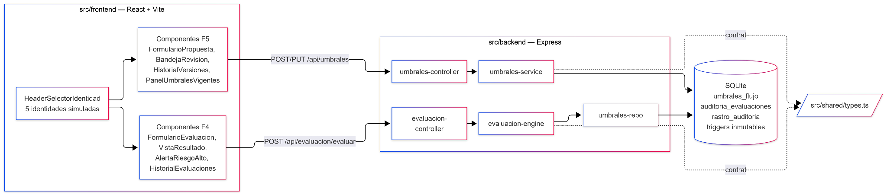
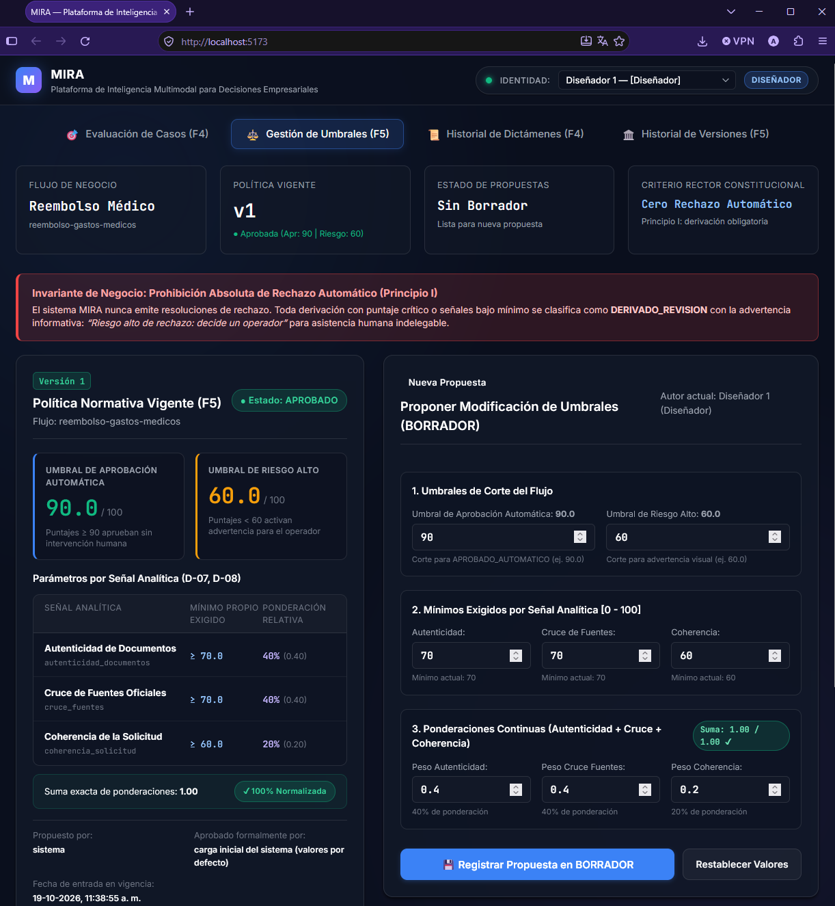
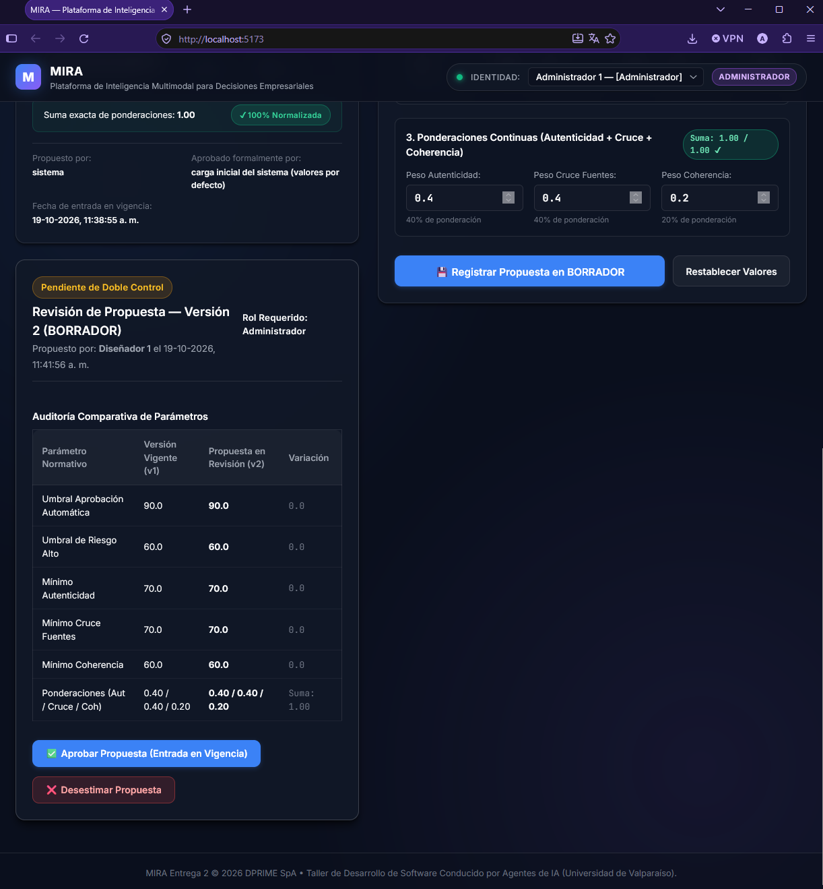
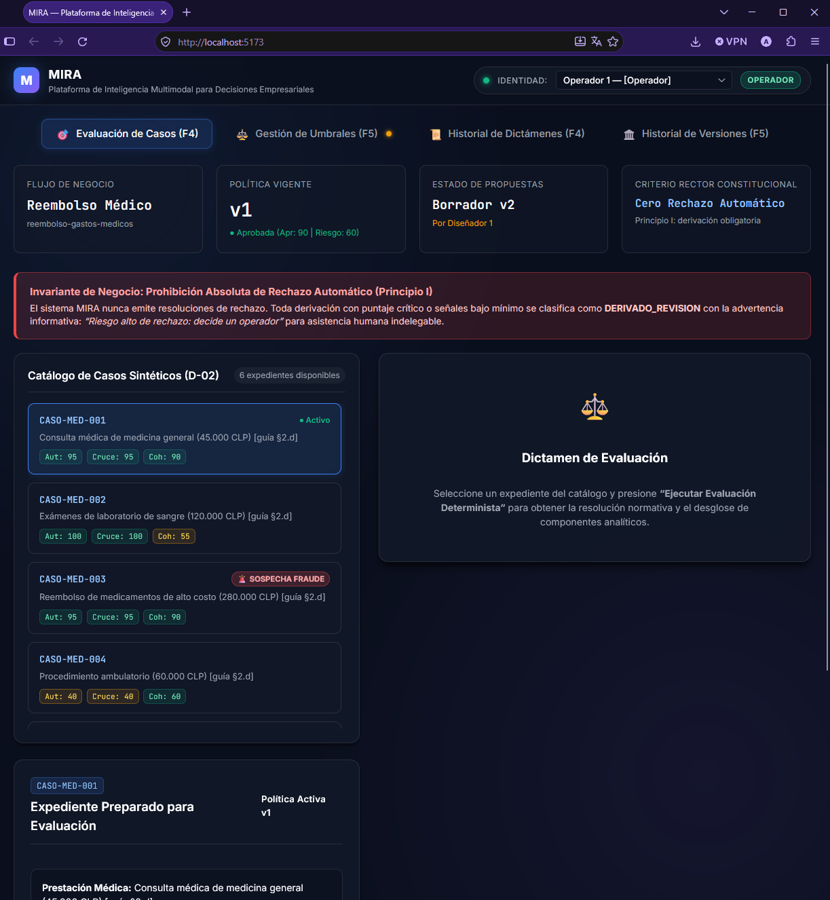
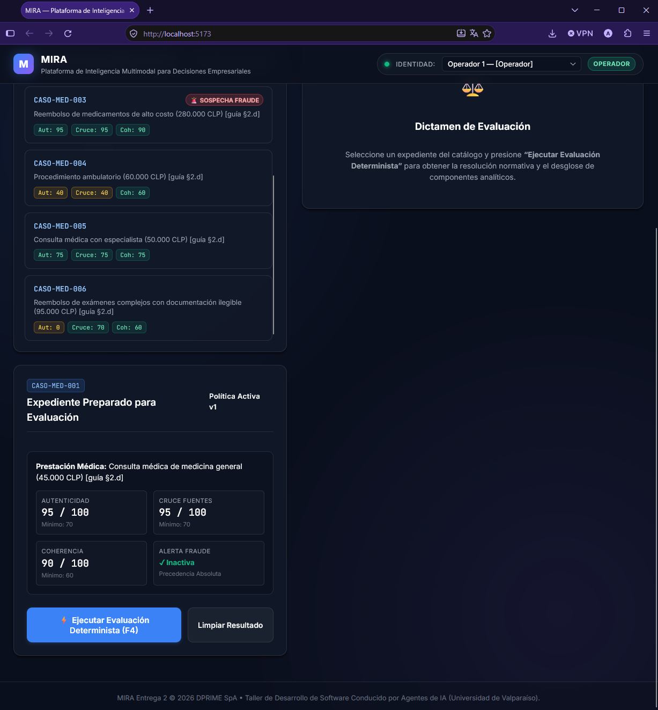

<!-- BORRADOR DE TRABAJO — no es el PDF final. Los bloques "> [EDITAR]" marcan lo único que falta llenar. -->

# GRUPO 4 — MIRA — Guerrero, Alvarez, González, Salgado

**Taller de Desarrollo de Software Conducido por Agentes de IA — Entrega 2**
Escuela de Ingeniería Informática, Facultad de Ingeniería, Universidad de Valparaíso

| Campo | Detalle |
|---|---|
| Caso de trabajo | MIRA — Plataforma de inteligencia multimodal para decisiones empresariales, DPRIME SpA |
| Método declarado | **SDD (Spec-Driven Development)** — GitHub Spec Kit `1.0.2.dev0` sobre Antigravity |
| Incremento construido | **F5 (Gestión de Umbrales)** + **F4 (Evaluación de Casos y Decisión)**, acotado al flujo de reembolso de gastos médicos |
| Equipo | Rodrigo Guerrero (Backend; representante del cliente en esta entrega), Jorge Alvarez (Frontend; no participó en la Entrega 1), Lester González (QA / Spec Kit / integración), Angel Salgado (Informe, trazabilidad, bitácora de decisiones, gobernanza documental) |
| Repositorio | `github.com/elesteber/proyecto-llm` — versión evaluada: tag `v2.0` > [EDITAR] |
| Fecha de entrega | Lunes 19 de octubre de 2026, 14:00 |

---

## 6.1 Resumen Ejecutivo

El equipo construyó, mediante Spec-Driven Development con GitHub Spec Kit, un incremento funcional completo de MIRA que integra dos funcionalidades conectadas productor-consumidor: **F5**, donde un Diseñador propone y un Administrador distinto aprueba los umbrales y pesos que rigen las decisiones, con versionamiento inmutable; y **F4**, que evalúa casos sintéticos de reembolso médico aplicando esos umbrales con precedencia estricta (fraude → señal bajo mínimo → umbral de aprobación → derivación general), sin emitir nunca un rechazo automático. El sistema corre en una máquina limpia en ≈45 segundos (criterio C4 cumplido con holgura) y las 51 tareas planificadas están implementadas con 51 pruebas unitarias/integración y 13 pruebas E2E en verde.

Los tres cambios más relevantes respecto del análisis de la Entrega 1: **(1)** el equipo cerró con el cliente, vía `/speckit-clarify`, un vacío que la E1 había dejado explícitamente pendiente (mínimos y pesos por señal, H-05), fijando valores concretos y configurables; **(2)** se formalizó mediante decisión del equipo (DEC-08) la eliminación completa de la opción de "rechazo automático" que la E1 permitía para puntajes bajo 60, sustituyéndola por derivación obligatoria con advertencia informativa; **(3)** una prueba de usabilidad con dos personas externas mostró que, aunque la suite automatizada E2E cumple el criterio de usabilidad `SC-005` (1 clic, <1 s), **personas reales no lo cumplen** (0 de 4 y 3 de 4 tareas) por problemas de descubribilidad de la interfaz — un hallazgo que la E1, al ser solo análisis sin construcción, no podía haber revelado.

Se recomienda, antes de pasar este incremento a producción, invertir en una pasada de diseño de interacción sobre la navegación (menús y selector de rol) y cerrar los dos hallazgos de la E1 que siguen sin resolución definitiva (SLA de latencia por tramos, H-11; tramos de facturación del cliente piloto, H-16), ninguno de los cuales bloqueaba este incremento pero sí bloquean una eventual puesta en producción completa.

---

## 6.2 Introducción y Selección de Funcionalidades

MIRA es la plataforma de inteligencia multimodal para decisiones empresariales que DPRIME SpA desarrolla para automatizar la evaluación de solicitudes (reembolsos de gastos médicos, en el piloto). La Entrega 1 (7 de septiembre de 2026, evaluada con nota 6,7) produjo un análisis de requisitos asistido por LLM: 415 afirmaciones estructuradas, un modelo de dominio de 26 entidades, 11 casos de uso, 49 requisitos funcionales/no funcionales consolidados en el informe PDF (75 en los documentos de fase, con una divergencia de numeración entre dos archivos de la Fase 5 nunca resuelta — ver `DEC-E2-02`), 16 inconsistencias detectadas (`H-01` a `H-16`) y 52 pruebas (40 funcionales + 12 extra-funcionales). Esta Entrega 2 toma ese análisis como entrada, no como documento archivado, y lo lleva a código.

**Equipo y rol de representante del cliente:** el equipo mantiene a sus 4 integrantes; Jorge Alvarez no participó en la Entrega 1, lo cual se declara aquí explícitamente. El rol de representante del cliente rota respecto de la E1: lo ejerce **Rodrigo Guerrero** (en la E1 lo ejerció Lester González). **Limitación declarada:** Rodrigo Guerrero integra a la vez el equipo desarrollador (backend) y ejerce el rol de representante del cliente — es la misma persona evaluando criterios de aceptación sobre código que ella misma escribió. Esta superposición de roles se declara explícitamente en el acta de aceptación (Anexo A) y se mitigó con el protocolo de `DEC-E2-03`: criterios de aceptación congelados antes de la sesión, Lester González y Jorge Alvarez presentes como observadores, y acta inmutable una vez firmada.

**Método:** se eligió **SDD con GitHub Spec Kit** (versión `1.0.2.dev0`) sobre el agente Antigravity, en vez de BMAD, por decisión explícita del equipo (`DEC-E2-01`): el flujo lineal de SDD (`constitution → specify → clarify → plan → tasks → analyze → implement`) se ajustaba mejor a un incremento de alcance acotado con una sola especificación consolidada, frente al modelo de roles con nombre de BMAD, pensado para equipos que simulan una organización completa.

**Funcionalidades elegidas — F5 (Gestión de Umbrales) + F4 (Evaluación de Casos y Decisión):** cumplen la regla de conexión productor-consumidor del enunciado (F5 produce la política vigente de umbrales/pesos; F4 la consume para decidir) y tocan directamente un hallazgo que la Entrega 1 dejó abierto como vacío declarado: `H-05`, "está pendiente de definir con el área de riesgo del cliente piloto qué señales llevarán un mínimo propio y sus valores" (`fase2/consolidacion-contradicciones.md`). Se descartaron los pares F4+F1 (alto riesgo técnico por la exclusión deliberada de `RQF-013` — tiempo restante — en la E1) y F4+F7 (`DEC-E2-04`).

**Stack tecnológico** (`DEC-E2-05`): Node.js (TypeScript) con Express en el backend, SQLite autocontenida vía `better-sqlite3` (sin contenedores Docker), React con Vite en el frontend, y Vitest/Supertest para pruebas unitarias/integración más Playwright para E2E. La interfaz está en español neutro profesional, operable de punta a punta sin devtools ni edición manual de base de datos.

---

## 6.3 Aplicación del Método

El equipo recorrió las 7 fases de SDD en orden estricto, sin escribir lógica de producción antes de `analyze` (Principio VI de la constitución), con un commit o PR por tarea y correcciones humanas siempre en commits `[HUMAN-FIX]` aparte.

**Constitución (`/speckit-constitution`):** produjo `.specify/memory/constitution.md`, 11 principios no negociables, cada uno citando explícitamente las decisiones `DEC` de la E1 o de esta entrega que lo fundamentan (ej. el Principio I —prohibición absoluta de rechazo automático— cita `DEC-08`, `DEC-E2-06` y la entrevista `ENT6`). *Corrección del equipo sobre lo que generó el agente:* la primera versión afirmaba una "ratificación unánime de los 4 integrantes" el mismo día en que se redactó, algo que no había ocurrido; Lester la corrigió a "ratificada por Lester, pendiente de lectura y aprobación del equipo" (`INT-023`). También se corrigió una exigencia de citación que habría forzado a inventar identificadores `RQF-Bxx` inexistentes para requisitos que no tienen equivalente en el PDF de la E1.

**Especificación (`/speckit-specify`):** produjo `specs/001-f5-f4-umbrales-evaluacion/spec.md`, con 12 requisitos funcionales (`FR-001` a `FR-012`), entidades de dominio, 6 User Stories priorizadas y 5 criterios de éxito medibles (`SC-001` a `SC-005`). *Antes y después de una corrección del equipo:* la primera versión del agente clasificó a Rodrigo Guerrero como "docente" en vez de representante del cliente, incluyó tecnologías (SQLite, "k6") dentro de un documento que debe describir solo reglas de negocio, usó notación LaTeX no soportada, e inventó un criterio de aceptación `AC-7` que no existía en la guía — las 7 correcciones quedaron en `INT-001`.

**Aclaración (`/speckit-clarify`):** Rodrigo Guerrero, como representante del cliente, resolvió con el agente las 5 preguntas que quedaban pendientes de la E1 (mínimos/pesos de señales, identidades del selector simulado, consistencia de umbrales, ausencia de SLA de latencia, criterio de usabilidad), dejando el acta en `docs/entregable2/clarificaciones.md` con **cero** marcadores `[NEEDS CLARIFICATION]`. La revisión cruzada la hicieron Jorge Alvarez y Angel Salgado.

**Plan (`/speckit-plan`):** generó la arquitectura técnica (`plan.md`, `data-model.md`, 3 contratos de API, `quickstart.md`), declarando explícitamente qué RQNF de la E1 atiende cada decisión técnica y cómo se verifica (ej. `RQNF-002` → prueba de reproducibilidad determinista). El contrato de datos `src/shared/types.ts` se congeló recién tras aprobar esta fase (Compuerta 3, PR #16), conforme al Principio VI.

**Tareas (`/speckit-tasks`) y análisis (`/speckit-analyze`):** produjeron `tasks.md` con 51 tareas en 7 fases. El análisis automatizado reportó 8 hallazgos de inconsistencia (`H1`-`H8` internos del análisis, no confundir con los `H-xx` de la E1), documentados y resueltos directamente sobre `plan.md` y `tasks.md` (`INT-013`), y formalizados como artefacto propio en `specs/001-f5-f4-umbrales-evaluacion/reporte-analisis-consistencia.md`.

**Implementación (`/speckit-implement`):** 39 commits `[TASK-xxx]` (algunos agrupan varios IDs) materializaron las 51 tareas con disciplina TDD por fase (tests en rojo antes de la implementación). Encima de ellos, **22 commits `[HUMAN-FIX]`** corrigieron errores del agente: aislamiento de bases de datos entre pruebas concurrentes, tipado de cookies, sincronización de `tsconfig.json`, desincronización de los umbrales mostrados en F4 respecto a la política vigente de F5, y un `useSession` con estado local que rompía la reactividad del selector de rol entre componentes.

**Qué fase aportó más valor y cuál fue más costosa:** la fase de Aclaración aportó el mayor valor relativo a su costo — 5 preguntas resueltas en una sola sesión cerraron ambigüedades que la E1 había dejado abiertas durante semanas. La fase de Implementación fue la más costosa en volumen de corrección: concentra los 22 commits `[HUMAN-FIX]` del proyecto (por convención de commits, ese prefijo se usa solo para código, no para specs/plan/tareas — ver Principio IX de la constitución), evidenciando que, aun con specs y plan aprobados, el código generado por el agente requirió revisión línea por línea antes de aceptarse. Esto es una medida distinta del `IRF` de Implementación (≥13,5%, ver 6.6): el `IRF` cuenta **archivos** tocados por al menos un `[HUMAN-FIX]` sobre el total de 52 archivos de `src/`+`tests/` (7 confirmados: `App.tsx`, `FormularioEvaluacion.tsx`, `VistaResultado.tsx`, `useSession.ts`, `session-api.test.ts`, `umbrales-api.test.ts`, `umbrales-repo.test.ts`), mientras que "22 de 22" cuenta **commits**, no archivos — un mismo archivo puede recibir varios de esos 22 commits.

---

## 6.4 Implementación

**Arquitectura:** monorepo con tres paquetes lógicos desacoplados — `src/backend` (Express 5, 18 archivos: controllers, services, repositories, middlewares, DB), `src/frontend` (React 19 + Vite, 19 archivos: componentes de F4 en `components/evaluacion/`, de F5 en `components/umbrales/`, selector de identidad en `components/common/`), y `src/shared/types.ts` como único contrato de datos entre ambos. F5 y F4 interactúan exclusivamente a través de SQLite y ese contrato — ningún componente de F4 muta directamente datos de F5 (Restricción 4 de la constitución).

**Modelo de datos efectivamente implementado:** 3 tablas SQLite (`umbrales_flujo`, `auditoria_evaluaciones`, `rastro_auditoria`), con triggers `trg_prevent_update_*`/`trg_prevent_delete_*` que abortan cualquier `UPDATE`/`DELETE`, y un índice único parcial que impide más de un borrador activo por flujo simultáneamente. El seed inicial carga la Versión 1 de umbrales (valores por defecto) y los 6 casos sintéticos de `data/casos_prueba.json`.

**Estado real del incremento — qué funciona, qué funciona parcialmente, qué quedó fuera:**
- **Funciona completo:** las 6 historias de usuario (US1-US6), el motor de decisión con precedencia estricta, el doble control de F5 con bloqueo de auto-aprobación (`403 Forbidden`), el versionamiento inmutable, y la reevaluación histórica determinista.
- **Funciona parcialmente:** la usabilidad de la interfaz. La suite automatizada mide y cumple el camino técnico mínimo (1 clic, <1 s), pero la prueba con dos personas externas sin inducción previa mostró que **no descubren ese camino por sí solas** — ver 6.5.
- **Quedó fuera de alcance (declarado, no oculto):** la decisión final humana del Operador sobre un caso derivado (supuesto 7.1(f), confirmado por Rodrigo Guerrero); pruebas de carga/latencia (sin SLA contractual, `H-11`); anonimización de datos personales en evidencia (`DEC-12`, fuera del alcance de F5/F4).

**Aporte del agente vs. el equipo (evidencia en el repo):** de 39 commits de implementación, 22 recibieron corrección humana posterior (`TIH = 56,4%`, ver 6.6). El agente escribió la primera versión de prácticamente todo el código y los 7 artefactos de las fases Constitución/Especificación/Aclaración/Plan/Tareas recibieron al menos una corrección humana sustantiva cada uno (`IRF = 100%` en esas 5 fases — ver 6.6).

---

## 6.5 Pruebas y Verificación

**Cobertura automatizada:** 51 pruebas unitarias/integración (Vitest/Supertest) + 13 pruebas E2E (Playwright), **100% en verde**, más `npx tsc --noEmit` sin errores. Las pruebas de negocio se derivan directamente de los 6 casos sintéticos de la guía (`CASO-MED-001` a `CASO-MED-006`), mapeados 1 a 1 a los criterios `AC-1` a `AC-6` de `spec.md`, y de una prueba unitaria técnica adicional (`PU-1`) que aísla la condición "dos o más señales bajo mínimo" con puntaje no crítico.

**Reglas del capítulo 3 y excepciones cubiertas:** precedencia de fraude sobre cualquier puntaje (`AC-3`), derivación por señal bajo mínimo con puntaje aprobatorio (`AC-2`), advertencia de riesgo alto sin alterar la decisión (`AC-4`, `AC-6`, `PU-1`), y bloqueo de auto-aprobación en F5 (E2E `doble-control-f5.spec.ts`).

**E2E por funcionalidad:** `doble-control-f5.spec.ts` (propuesta → bloqueo 403 → aprobación por rol distinto) y `evaluacion-f4.spec.ts` (los 6 dictámenes deterministas en navegador).

**Prueba extra-funcional medible:** `tests/reproducibility/deterministic.test.ts` exige y verifica 100% de reproducibilidad determinista al reevaluar un caso histórico contra la versión de umbrales archivada (`SC-004`, heredada de `RQNF-002 [fase5-lester]` / `H-14`). El equipo decidió explícitamente no construir una prueba de latencia: la E1 (`H-11`) ya había mostrado que el requisito original de "5 segundos" era técnicamente inviable, y no hay datos de carga reales para fijar un SLA creíble.

**Prueba de usabilidad con integrante externo — resultado no satisfactorio, declarado con honestidad:** Lester González ejecutó la prueba el 18-oct con **2 personas externas al curso** (consentimiento, identificadas solo por iniciales). Resultado frente a `SC-005` (≤2 clics de consulta, ≤3 min de tarea, sin asistencia): **3 de 8 ejecuciones de tarea cumplieron**, y una de ellas sin recuento de clics registrado; el segundo participante no cumplió ninguna de las 4 tareas sin ayuda. Defecto dominante: los menús de navegación y el selector de rol "no se perciben como interactivos en el primer contacto" y se describieron como "chiquititos"/"muy pequeños" (cita textual de ambos participantes, `docs/entregable2/usabilidad.md`). Esto **contrasta** con la prueba E2E automatizada (`usabilidad-recorrido.spec.ts`), que sí cumple `SC-005` porque mide el camino técnico mínimo, no si una persona lo descubre — la propia matriz de trazabilidad (`docs/entregable2/matriz-trazabilidad-tareas.md`, §E.2) documenta esta brecha explícitamente.

**Sesión formal de aceptación con el representante del cliente:** Rodrigo Guerrero (representante del cliente) aceptó el incremento el 19-oct (00:15-00:38, videollamada; demo de Lester González; versión demostrada `main @ b9f5f2d`). Se recorrieron 12 escenarios (propuesta y aprobación de umbrales con doble control, los 6 dictámenes de F4, reevaluación determinista) y los 12 dieron el resultado esperado — **resultado: Aceptado con observaciones**. El cliente registró dos observaciones de diseño: la puntuación del dictamen se ve "muy pequeña y opacada por los demás textos" y "hay algunas opciones que es necesario escrolear para encontrar", y reaccionó al hallazgo de usabilidad de la sección anterior pidiendo una interfaz "más responsiva e intuitiva para la gente que no sea experta". Por falta de tiempo, las 3 acciones correctivas derivadas de estas observaciones no se implementan en esta entrega y quedan declaradas como defecto conocido para la siguiente iteración. Acta completa en el Anexo A.

**Advertencia aplicada:** se verificó que las pruebas automatizadas comprueban los criterios de aceptación de la E1/spec (valores de entrada y salida fijados de antemano en la guía), no el comportamiento que el código ya tenía — el hallazgo de usabilidad de arriba es evidencia de que esta disciplina se mantuvo: una prueba que solo confirmara su propia implementación no habría podido mostrar ese resultado.

---

## 6.6 Comparativa con la Entrega 1

### 6.6.A — Evolución de los 12 requisitos funcionales del incremento (Tabla 6.6-A)

| Requisito E2 | Clasificación | Qué cambió | Origen | Evidencia |
|---|---|---|---|---|
| `FR-001` (proponer modificación de umbrales) | Sin cambio | — | — | `RQF-044`/`RQF-039` |
| `FR-002` (aprobación por rol distinto) | Sin cambio | — | — | `RQF-039` |
| `FR-003` (suma de pesos = 1,00; rango 0-100) | Sin cambio | — | — | `RQF-044` |
| `FR-004` (historial inmutable de versiones) | **Modificado** | De RNF (`RQNF-002`) a requisito funcional explícito con DDL de triggers | Equipo | `DEC-14` |
| `FR-005` (cálculo de puntaje ponderado) | Sin cambio | — | — | `RQF-040` |
| `FR-006` (aprobación automática ≥90) | **Modificado** | El umbral 85 vs 80 (contradicción interna de la E1) se fijó en ≥90 | Equipo + cliente piloto (ENT4) | `DEC-01` |
| `FR-007` (precedencia de fraude) | Sin cambio | — | — | `RQF-023` |
| `FR-008` (derivación por señal bajo mínimo) | Sin cambio | — | — | `RQF-041` |
| `FR-009` (derivación en rango intermedio) | **Modificado** | Reconciliación de una colisión de IDs entre dos archivos de la Fase 5 (`RQF-020` vs `RQF-004`) | Equipo (auditoría de citas) | `DEC-E2-02` |
| `FR-010` (prohibición absoluta de "rechazado") | **Nuevo** | No existía como requisito textual en la E1; reemplaza el rechazo automático del tramo bajo 60 | Equipo, por exigencia de Cumplimiento (ENT6) | `DEC-08` |
| `FR-011` (advertencia informativa de riesgo alto) | **Nuevo** | El umbral 60 de la E1 deja de rechazar y pasa a ser solo informativo | Equipo | `DEC-08`, `DEC-E2-10(b)` |
| `FR-012` (reproducibilidad determinista) | **Modificado** | De "reproducibilidad exacta" (inviable con modelos generativos) a "trazabilidad" | Equipo, por objeción técnica (ENT3) | `DEC-14` |

**Resumen:** 7 sin cambio, 3 modificados, 2 nuevos, 0 diferidos por alcance (los 12 FR cubren el 100% del alcance declarado de F4+F5).

### 6.6.B — Hallazgos de la Entrega 1 y su estado en la Entrega 2 (Tabla 6.6-B)

| H-xx | Qué decía la E1 | Estado en la E2 | Evidencia |
|---|---|---|---|
| H-01 | Contradicción 85 vs 80 en el umbral de aprobación automática | **Cerrada** — fijado en ≥90 | `DEC-01` |
| H-02 | 90 días (plataforma) vs 5-10 años (aseguradora) de retención | **Cerrada, fuera de alcance F4/F5** — 90 días activo + archivo frío | `DEC-02` |
| H-03 | Sin definir comportamiento ante exceso de rate limit | **Cerrada, fuera de alcance F4/F5** — modo bulk + `Retry-After` | `DEC-03` |
| H-04 | Disputa sobre si se cobran casos derivados | **Cerrada, fuera de alcance F4/F5** — no se cobran | `DEC-04` |
| H-05 | Mínimos/pesos de señales sin definir | **Cerrada en clarify (14-oct)** — 70/70/60, 0,40/0,40/0,20 | `DEC-05` |
| H-06 | Credenciales propias vs SSO corporativo | **Cerrada para producción; simulada en E2** con selector de rol | `DEC-06` |
| H-07 | Transcripción manual vs escritura automática de resultados | **Cerrada, fuera de alcance F4/F5** — automática | `DEC-07` |
| H-08 | Rechazo automático permitido bajo 60 puntos | **Cerrada** — prohibido; siempre deriva | `DEC-08` |
| H-09 | Disputa sobre cobro de reevaluaciones | **Cerrada, fuera de alcance F4/F5** — 1 validación salvo reanálisis sustantivo | `DEC-09` |
| H-10 | Cronograma formal (abril 2027) vs compromiso comercial (enero) | **Cerrada para esta entrega** — rige el cronograma formal; tensión registrada como riesgo `R-11` | `DEC-10` |
| H-11 | SLA de 5 segundos técnicamente inviable | **⚠️ Parcialmente abierta** — estructura por tramos definida, valores numéricos pendientes de pruebas de carga | `DEC-11` |
| H-12 | Rastro inalterable vs. derecho de eliminación de datos personales | **Cerrada, fuera de alcance F4/F5** — se separa metadato de decisión (inalterable) de evidencia personal (anonimizable) | `DEC-12` |
| H-13 | API REST vs. intercambio de archivos para el cliente piloto | **Cerrada, fuera de alcance F4/F5** — se soportan ambos | `DEC-13` |
| H-14 | Reproducibilidad exacta de modelos generativos, técnicamente inviable | **Cerrada** — redefinida como trazabilidad; es la prueba extra-funcional oficial (`SC-004`) | `DEC-14` |
| H-15 | Meta de 2 semanas de onboarding vs. 2-3 semanas con formulario propio | **Cerrada, fuera de alcance F4/F5** | `DEC-15` |
| H-16 | Tramos de facturación insuficientes para el volumen del cliente piloto | **⚠️ Abierta** — propuesta sin validar con finanzas | `DEC-16` |

**14 de 16 hallazgos cerrados; 2 siguen abiertos/parciales de forma declarada** (ninguno bloquea el alcance F4/F5 de este incremento).

### 6.6.C — Indicadores cuantitativos

> Cálculo completo, con metodología y datos crudos, en `entregable2/borrador-indicadores-6.6.md`. Resumen:

| Indicador | Fórmula | Valor |
|---|---|---|
| **TPR** (Preservación de Requisitos Must) | Must de F4/F5 sin cambio / Must de F4/F5 | **4/8 = 50%** *(base E1; ver nota metodológica abajo)* |
| **TIH** (Intervención Humana en Código) | Commits de corrección humana / Commits de tareas | **22/39 = 56,4%** |
| **IRF** (Retrabajo por Fase) | Artefactos con corrección sustantiva / Artefactos de la fase | **100% en Constitución, Especificación, Aclaración, Plan y Tareas; 0/1 en Análisis (artefacto reconstruido, ver nota); ≥13,5% en Implementación** > [EDITAR: cerrar con el detalle completo del commit `fdfc199`] |

**Nota de honestidad metodológica (declarar en el informe, no ocultar):** parte de la documentación de esta misma Entrega 2 —las fichas `DEC-02` a `DEC-16` y el cálculo de estos mismos indicadores— se produjo con asistencia de un agente de IA (Claude Code) operando bajo la identidad de commit de Angel Salgado, en ramas todavía no fusionadas al momento de este borrador. Esos commits **se excluyen deliberadamente** de los indicadores de arriba, porque mezclarlos mediría la intervención de un agente sobre su propia documentación, no la intervención humana real del equipo durante el ciclo SDD. Se declara como inconsistencia propia de la E2, no heredada de la E1.

### 6.6.D — Preguntas guía

**A. Requisitos**
- *¿Qué requisitos cambiaron?* Ver Tabla 6.6-A: 5 de 12 (42%) cambiaron (3 modificados, 2 nuevos). Los más relevantes: `FR-010`/`FR-011` (eliminación del rechazo automático) porque invierten una regla de negocio explícita de la E1, y `FR-006` (umbral ≥90) porque resuelve una contradicción interna nunca corregida en el documento original.
- *¿Qué Must de la E1 no llegaron a especificación, tarea o prueba?* Ninguno de los 8 Must en alcance F4/F5 quedó fuera; los 8 llegaron a `spec.md`, a `tasks.md` y a al menos una prueba.
- *¿Qué agregó el agente sin respaldo en ninguna fuente?* La primera versión de la spec clasificó a Rodrigo como "docente", incluyó SQLite y "k6" en un documento de reglas de negocio, e inventó `AC-7`. Se rechazó todo (`INT-001`).
- *¿Qué RNF no pudieron traducirse en prueba automatizada?* El SLA de latencia (`H-11`): no por limitación del método, sino porque el requisito original de la E1 (5 segundos) ya había sido identificado como no verificable en la propia E1.

**B. Supuestos y decisiones**
- *¿Los supuestos se mantuvieron?* No todos: `DEC-01`, `DEC-08`, `DEC-14` invalidan supuestos/reglas literales de la E1 al bajar a especificación — los detectó el equipo, no el agente ni el cliente, al redactar la constitución y la spec.
- *¿Qué decisiones de la bitácora respetó el método y cuáles reabrió?* Respetó `DEC-08` (no rechazo automático) sin desviarse. Reabrió implícitamente `H-05` y `H-11`, que la E1 había dejado como "pendiente" sin fecha — el método SDD forzó resolverlos (vía clarify) o declararlos explícitamente abiertos, en vez de dejarlos ambiguos indefinidamente.
- *¿Qué ambigüedades resolvió el agente por su cuenta?* La relación `RQF-020` vs `RQF-004` (colisión de IDs, `FR-009`) la detectó y corrigió Lester, no el agente — el agente había copiado la cita errónea de la spec de negocio sin verificarla (`INT-010`).

**C. Inconsistencias**
- *¿Qué hallazgos de la E1 siguen abiertos?* `H-11` (parcial) y `H-16` (abierta) — ver 6.6.B.
- *¿Qué hallazgos nuevos aparecieron solo al implementar?* Ninguna inconsistencia de requisitos nueva; sí aparecieron defectos de usabilidad (menús poco descubribles) que no son inconsistencias documentales sino hallazgos de diseño de interacción, solo visibles al construir y probar con personas reales.

**D. Modelo y calidad**
- *¿Cambió el modelo de dominio?* Se añadieron atributos no previstos en el modelo de 26 entidades de la E1: `riesgoAltoRechazo` (booleano informativo) y los 3 estados de `UmbralesFlujo` (`BORRADOR`/`APROBADO`/`DESESTIMADO`), ninguno presente en el modelo original.
- *¿Los criterios de aceptación de la E1 eran lo bastante precisos?* Para `PF-033` (dos aprobaciones) sí, pero contradecía la spec en quién propone (Administrador en el texto de la prueba, Diseñador en la decisión del equipo) — se documentó la diferencia (`DEC-E2-10(d)`) en vez de alterar silenciosamente la prueba.

**E. Proceso**
- *¿Qué artefacto de la E1 fue más útil como entrada?* La tabla de hallazgos (`H-01` a `H-16`) — se convirtió directamente en las 16 fichas `DEC` de esta entrega. El menos útil: el informe PDF consolidado, que mezcla dos numeraciones de requisitos distintas sin advertirlo.
- *¿Cuánto escribió el equipo y cuánto el agente?* `TIH = 56,4%` (22 de 39 commits de tarea recibieron corrección humana después) es la evidencia cuantitativa; cualitativamente, el agente escribió el primer borrador de todo, el equipo decidió y corrigió sistemáticamente antes de aceptar.

---

## 6.7 Discusión

El método aportó estructura donde la Entrega 1 solo tenía prosa: las 16 inconsistencias detectadas en la E1 quedaron como una tabla sin fecha de cierre; SDD, al exigir una constitución y una especificación citables, forzó al equipo a decidir 14 de ellas con fecha y ficha, y a declarar explícitamente las 2 que siguen abiertas en vez de dejarlas flotando. Donde el método se sintió más burocrático que útil fue en la exigencia de un reporte de `/speckit-analyze` como artefacto separado (`DEC-E2-09`): el equipo resolvió los 8 hallazgos del análisis directamente sobre `plan.md` y `tasks.md`, que es donde tenían efecto, y el archivo separado terminó siendo una casilla de la Definición de Terminado sin contenido propio que agregar.

La constitución y la spec lograron que el agente respetara las decisiones de la E1 en lo normativo (nunca generó código que rechazara automáticamente un caso, por ejemplo), pero fallaron en lo factual: el agente inventó una cita de entrevista (`ENT6 [00:04:06]` usada para dos afirmaciones distintas), clasificó mal un rol, y afirmó una "ratificación unánime" que no había ocurrido. Ninguno de estos errores era sutil — todos se detectaron en la primera revisión humana — pero el patrón importa: el agente tiende a redactar con la confianza de quien ya verificó, no con la cautela de quien está citando de memoria.

Lo que se perdió entre la especificación y el código fue, paradójicamente, lo que el código no podía perder: la especificación describe un sistema donde los umbrales "son modificables dinámicamente" y "quedan versionados con trazabilidad inmutable" — y el código efectivamente lo hace — pero ninguna palabra de la spec advertía que un usuario sin inducción previa no encontraría el menú para hacerlo. Esa brecha entre "la regla de negocio está bien implementada" y "una persona puede operarla" no es un defecto de SDD: es un límite de cualquier especificación textual, que describe comportamiento, no percepción.

Comparado con el prompting directo de la Entrega 1 (sin construir software), este trabajo exigió mucho más esfuerzo de verificación por unidad de avance — `TIH = 56,4%` lo cuantifica — pero a cambio dio control real: cada decisión de diseño quedó en una ficha citable, no en una interpretación tácita del prompt. Con BMAD probablemente se habría obtenido una especificación de interfaz más temprana (es obligatoria en ese método desde el rol de UX Expert), lo que quizás habría anticipado el hallazgo de usabilidad antes de llegar a la prueba con personas externas, en vez de descubrirlo al final.

---

## 6.8 Conclusiones

El equipo sabe hacer ahora algo que no sabía al terminar la Entrega 1: operar un ciclo completo de Spec-Driven Development sobre un incremento real, incluyendo el trabajo de verificación que el método no automatiza — citar correctamente, detectar cuándo el agente generaliza sin fuente, y medir cuantitativamente cuánta de esa verificación fue necesaria (`TIH`, `TPR`, `IRF`). También aprendió que un sistema puede cumplir el 100% de sus criterios de aceptación automatizados y seguir siendo difícil de usar para una persona real — una distinción que la Entrega 1, al no construir nada, no tenía forma de revelar.

Queda pendiente para la siguiente entrega: cerrar `H-11` y `H-16` con datos reales (pruebas de carga y validación comercial) y rediseñar la descubribilidad de la navegación de F4/F5 a partir de los defectos documentados en la prueba de usabilidad.

---

## Anexos

- **Matriz de trazabilidad completa:** `docs/entregable2/matriz-trazabilidad-tareas.md` (FR/RQF → AC/SC → tareas → tests, con sección de brechas declaradas §E).
- **Bitácora de intervenciones humanas:** `docs/entregable2/bitacora-intervenciones.md` (`INT-001` a `INT-023`).
- **Bitácora de decisiones de diseño:** 16 fichas `DEC-01` a `DEC-16` + 10 fichas `DEC-E2-01` a `DEC-E2-10`, en `entregable2/guia-implementacion-sdd.md` (sección 1).
- **Acta de clarificación con el cliente:** `docs/entregable2/clarificaciones.md`.
- **Prueba de usabilidad con personas externas:** `docs/entregable2/usabilidad.md`.
- **Sesión formal de aceptación con el cliente:** `docs/entregable2/sesion-aceptacion.md` — texto completo en el Anexo A.
- **Indicadores cuantitativos (cálculo completo):** `entregable2/borrador-indicadores-6.6.md`.
- **Reporte de análisis de consistencia:** `specs/001-f5-f4-umbrales-evaluacion/reporte-analisis-consistencia.md`.
- **Constitución del proyecto:** `.specify/memory/constitution.md`.
- **Especificación, plan y tareas:** `specs/001-f5-f4-umbrales-evaluacion/` (`spec.md`, `plan.md`, `tasks.md`, `data-model.md`, `contracts/`).
- **Registro de comandos `/speckit-*` ejecutados:** `entregable2/registro-comandos-speckit.md` — qué comando, quién, cuándo y en qué commit/PR. Los prompts literales no se incluyen porque Antigravity no ofrece función de exportación de historial de prompts; este registro documenta en su lugar lo verificable en git (comando, autor, fecha, commit).
- **Evidencia de la sesión de aceptación:** `docs/entregable2/evidencia/sesion-aceptacion-historial-evaluaciones.json`, `...-historial-umbrales.json`.
- **Capturas de pantalla de la interfaz:**

**Gestión de Umbrales (F5)**

**Evaluación de Casos (F4)**

- **Repositorio y tag evaluado:** `github.com/elesteber/proyecto-llm`, tag `v2.0` > [EDITAR].

---

## Anexo A — Acta de la sesión formal de aceptación con el cliente

*(texto completo de `docs/entregable2/sesion-aceptacion.md`)*

### A.1 Datos de la sesión

| Campo | Valor |
|---|---|
| Fecha | 2026-10-19 |
| Hora de inicio / término | 00:15 / 00:38 |
| Medio | Videollamada |
| Representante del Cliente | Rodrigo Guerrero |
| Demostración | Lester González |
| Acta | Lester González |
| Otros asistentes | Angel Salgado |
| Versión demostrada | `main` en el commit `b9f5f2d` |
| Preparación del entorno | `rm -f data/mira.db*` y `npm run db:seed` (base sembrada el 2026-10-18 a las 23:58); `npm run dev`; navegador |

**Declaración de rol:** Rodrigo Guerrero integra el equipo desarrollador (backend) y actúa como Representante del Cliente por asignación del taller. La aceptación se registra bajo ese rol.

**Alcance:** incluido F5 (configuración de umbrales con doble control) y F4 (evaluación de casos por umbrales). Fuera de alcance de este incremento: la decisión final humana del Operador sobre casos derivados (`spec.md`, supuesto (f)) y el SLA numérico (`H-11`).

### A.2 Escenarios demostrados

| # | Escenario | Pasos resumidos | Resultado esperado | Criterio | Resultado observado | Decisión |
|---|---|---|---|---|---|---|
| 1 | Consultar la política vigente (F5) | Abrir la pestaña de umbrales | Se muestra la versión vigente (v1) | — | Versión 1, umbral de aprobación 90, cargada por el sistema. | Sí |
| 2 | Proponer una nueva versión (F5) | Como Diseñador 1, proponer umbral de aprobación 92 | Se crea un borrador con versión correlativa | — | Versión 2 propuesta (00:19). | Sí |
| 3 | Doble control (F5) | Intentar aprobar como el mismo proponente; intentar proponer como Administrador | Ambos intentos son rechazados | — | Bloqueado como esperado; cubierto además por `tests/integration/umbrales-api.test.ts`. | Sí |
| 4 | Aprobación independiente (F5) | Cambiar a Administrador 1 y aprobar | La versión 2 entra en vigencia; la 1 queda en el historial | — | Aprobada a las 00:21. | Sí |
| 5 | Historial de versiones (F5) | Abrir el historial | Se listan las versiones; las cerradas no son modificables | — | Lista v1 (carga inicial), v2 (Diseñador 1 → Administrador 1) y v3 (Diseñador 1 → Administrador 2, 00:38). Inmutabilidad verificada por `tests/integration/auditoria-inmutable.test.ts`. | Sí |
| 6 | CASO-MED-001 (F4) | Evaluar el caso | `APROBADO_AUTOMATICO` | AC-1 | Puntaje 94, `aprobado`, `riesgoAltoRechazo: false`. | Sí |
| 7 | CASO-MED-002 (F4) | Evaluar el caso | `DERIVADO_REVISION` por `senal_bajo_minimo` | AC-2 | Puntaje 91, coherencia 55 < 60. Evaluado dos veces (00:24, 00:28) con el mismo resultado. | Sí |
| 8 | CASO-MED-003 (F4) | Evaluar el caso | `DERIVADO_REVISION` por `alerta_fraude` | AC-3 | Puntaje 94 con fraude activo; deriva igual. | Sí |
| 9 | CASO-MED-004 y 006 (F4) | Evaluar ambos | `riesgoAltoRechazo` informativo, sin rechazo automático | AC-4, AC-6 | Puntajes 44 y 40; ambos `DERIVADO_REVISION`/`senal_bajo_minimo`, `riesgoAltoRechazo: true`. | Sí |
| 10 | CASO-MED-005 (F4) | Evaluar el caso | `DERIVADO_REVISION` por `puntaje_bajo_umbral` | AC-5 | Puntaje 75, sin señales bajo mínimo. | Sí |
| 11 | Reevaluación determinista (F4) | Reevaluar un registro histórico | Reproduce el dictamen original al 100% | SC-004 | 11 reevaluaciones registradas, todas exitosas. | Sí |
| 12 | Regla transversal | Revisar todos los resultados | Ningún caso termina en rechazo automático | — | 1 `APROBADO_AUTOMATICO` + 6 `DERIVADO_REVISION`; cero rechazos. | Sí |

Evidencia cruda de la API al cierre de la sesión: `docs/entregable2/evidencia/sesion-aceptacion-historial-evaluaciones.json` y `...-historial-umbrales.json`.

### A.3 Hallazgos de usabilidad comunicados al cliente y reacción

Se informó el resultado de la prueba con personas externas (`docs/entregable2/usabilidad.md`): `SC-005` no se cumple en la dimensión manual. Reacción textual del cliente:

> mi reaccion es que nececitan hacerlo mas responsivo y de mas intuitivo para la gente que no sea experta

### A.4 Resultado y observaciones del cliente

**Resultado: Aceptado con observaciones.**

Observación textual del cliente:

> el tamaño de la puntuacion que se genera en la evaluacion es muy pequeña y es opacada por los demas textos. Hay mucha informacion en pantalla que no es relevante para lo que se va a realizar o aparece varias veces presentada, lo cual genera confusiones y hay algunas opciones que es necesario escrolear para encontrar lo cual puede confundir a los usuarios.

**Acciones derivadas (el equipo decidió el 19-oct dejarlas para iteraciones futuras, por falta de tiempo):**

| # | Acción | Responsable | Plazo |
|---|---|---|---|
| 1 | Aumentar el tamaño de la puntuación y reducir texto repetido | Por asignar | Iteración futura |
| 2 | Evitar que opciones clave requieran scroll | Por asignar | Iteración futura |
| 3 | Hacer más visibles los menús y el selector de rol; instructivo inicial breve | Por asignar | Iteración futura |

No se implementan en esta entrega; se declaran como defecto conocido en el informe. Confirmación final de la categoría de aceptación a cargo de Rodrigo Guerrero, con su aprobación y comentario en el PR que incorpora esta acta.
